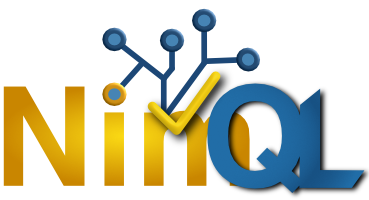

```
   _._
 o|- -|o This file is licensed under CC BY-NC-SA 4.0 international license.
  ( l )  To view a copy of this license, visit http://creativecommons.org/licenses/by-nc-sa/4.0/
    =    Author: jean-marc "jihem" quere 2026
```

[](https://lipunila.sonaliwan.fr)
## NimQL
> Lab'Oratoire / Project magenta – Laboratory of Cognitive and Social Psycholinguistics
> https://lipunila.sonaliwan.fr – metalab(at)sonaliwan.fr (french)

**sonaliwan/nimql** is a declarative logic interpreter written in Nim, very close to Prolog in spirit: it's an SLD resolution engine (unification + backtracking) equipped with a fact/rule database, a Prolog-like term parser, and a small layer for arithmetic evaluation and comparison. The program is used from the command line, with:
- an interactive REPL mode (with command history via linenoise),
- a script mode (a .ql file loaded at startup),
- a direct command-line query mode.

The project is in active development (ß.3). The goal of publishing it is to let everyone experiment with the chosen approach in order to have constructive exchanges around the project and the goals to be achieved.

|File|Role|
|----|----|
|term.nim|Term type (atoms, variables, integers, strings, compound terms) + display|
|rule.nim|Rule| type (clause head + body)|
|database.nim|Rule database (Database = seq[Rule]) + substitution resolution (walk)|
|parser.nim|Recursive-descent parser for the language (terms, lists, expressions, rules)|
|solver.nim|Unification engine and SLD resolution (solve), handling of special predicates|
|integer.nim|Arithmetic evaluation (is) and numeric comparisons|
|boolean.nim|var/nonvar predicates|
|io.nim|write/writeln predicates|
|engine.nim|Interprets REPL/file commands (consult, list, kill, write, ? queries)|
|nimql.nim|Entry point: CLI, REPL with linenoise, Ctrl-C handling|

## REPL commands (and :- directives in files)

|Command|Effect|
|----|----|
|fact. / rule. (e.g.: pere(jean, paul).)	Adds a fact or rule to the database|
|rule :- body1, body2.|	Adds a rule with a body (conjunction of goals)|
|? query.(or ?- query. in a file)|	Evaluates a query, displays true./false. or the variable substitutions|
|list	Lists all| facts/rules in the database|
|list \<domain\>|	Lists only the clauses whose head has this functor name|
|kill \<domain\>|	Removes all clauses whose head matches this name|
|consult("file.ql")|	Loads a .ql file into memory (adds clauses / runs directives)|
|write(X) / writeln(X)|	Displays a term, with or without a newline|
|exit, quit, Ctrl-C|	Quits the REPL|

## Command line
```
nimql                    # starts the REPL (loads nimql.ql at startup if it exists)
nimql file.ql            # loads the file, then starts the REPL
nimql file.ql "goal."    # loads the file and runs a single query
```

## Language syntax (close to Prolog)
- Atoms: `jean`, `'atom with spaces'`
- Variables: start with an uppercase letter or `_` → `X`, `Name`, `_`
- Integers: `42`
- Strings: `"text"`
- Compound terms: `pere(jean, paul)`
- Prolog lists: `[]`, `\[a, b, c\]`, `\[Head | Tail\]`
- Comments: `# line`
- Rules: `head :- goal1, goal2, ...` terminated by a `.`
- Arithmetic expressions: `+ - * / % ^`, evaluated via the predicate is: `X is 2 + 3`
- Comparisons: predicates `eq/2`, `neq/2`, `gt/2`, `lt/2`, `geq/2`, `leq/2`
- Binding tests: `var(X)`, `nonvar(X)`
- Input/output: `write(X)`, `writeln(X)`

The resolution engine (`solver` in `solver.nim`) implements classic SLD resolution: unification (`unify`), variable renaming (`refreshVars`) on each rule call to avoid collisions, and depth-first traversal with implicit backtracking (accumulating all solutions in `result`).

## Comparison with existing tools
NimQL belongs to the family of logic languages inspired by Prolog, with a deliberately reduced subset (no cut !, no explicit negation as failure, no dynamic assert/retract in the classic Prolog sense — replaced here by list/kill). It can be compared to:
- SWI-Prolog — https://www.swi-prolog.org/ — the reference Prolog implementation, much more complete (I/O, constraints, modules, web).
- GNU Prolog — https://www.gprolog.org/ — a lightweight Prolog implementation in C, philosophically close to the "small implementation" that NimQL offers.
- Datalog (e.g. Soufflé — https://souffle-lang.github.io/) — a logic subset without complex compound terms or deep negation, geared toward queries on fact databases, fairly close in usage to what NimQL does with list/kill/?.
- miniKanren — http://minikanren.org/ — a minimalist unification/logic engine, often reimplemented "from scratch" in other languages (as here in Nim), for educational purposes.
- Tau Prolog (JS) — http://tau-prolog.org/ — an example of a Prolog implementation "hosted" in a host language, the same approach as NimQL in Nim.

Typical uses for this type of tool: simple expert systems, business rule engines, knowledge base prototyping, educational exercises on logic programming, small combinatorial constraint solvers (kinship, graphs, logic puzzles).

## Planned developments (broad outline)
### ß.4
- Addition of cut (!) and negation (+) handling
- Improved error handling (except generic Exception)
- Addition of string support (not just for display)
### ß.5
- Addition of file I/O handling
- Addition of format handling
### ß.6
- Addition of float handling
### ß.7
- Addition of HTTP/HTTPS I/O handling
### ß.8
- DUCKDB integration
### ß.9
- Addition of agents (to model multi-agent systems)

Note that things won't necessarily happen in the order described.
WARNING: this version is not finalized. The query language itself (precise syntax of rules/facts, operators) is subject to change, as are the `nql/*` modules.

### One more thing!
A small gesture that can—hugely—help us out... [Caffeine is important for a team of neurodivergent individuals: ASD, ADHD, GAD, gifted IQ and highly/exceptionally gifted (members of **mensa.fr** and **triplenine.org**).]

[](https://buymeacoffee.com/sonaliwan.fr)
